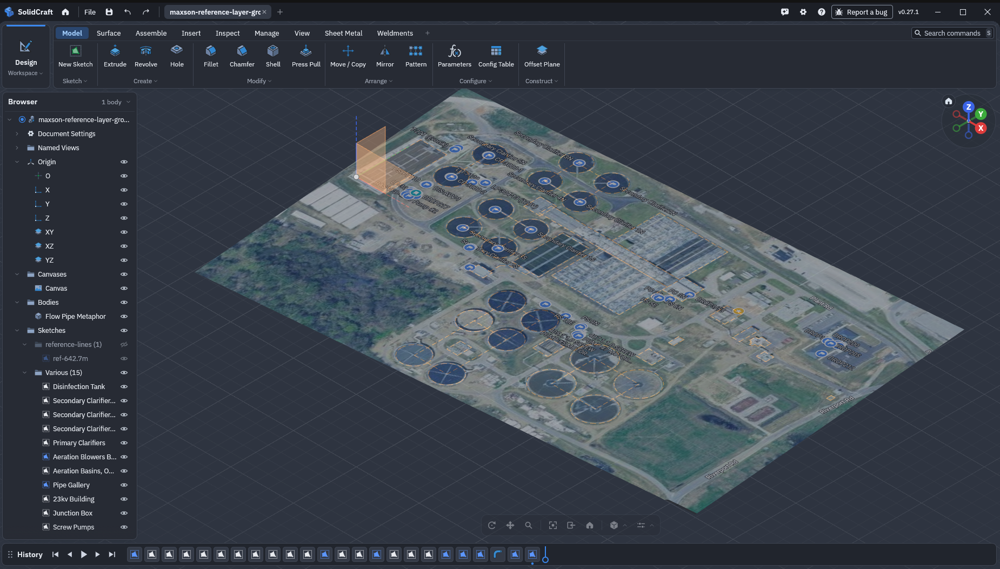

# maxson-cad

I recommend that any plant engineer insist on recieving digital drawings and CAD assets from contractors, rather than simply accepting PDF files and printed flatfiles. 

Now, we claw our way into the future. 

    

